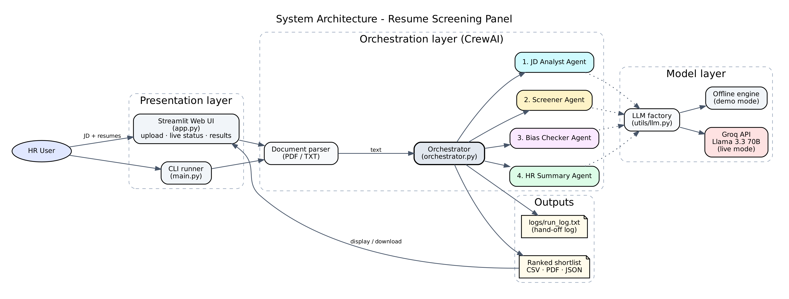
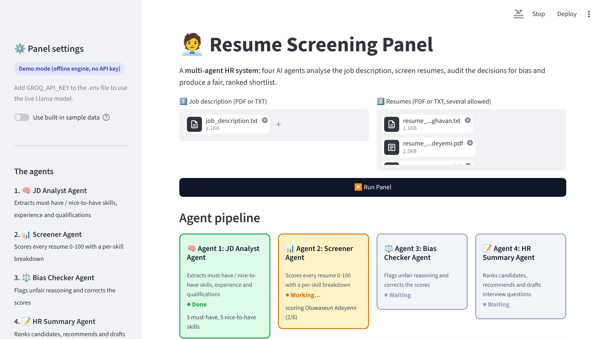
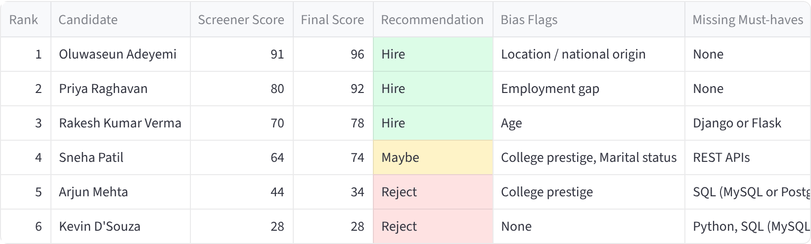
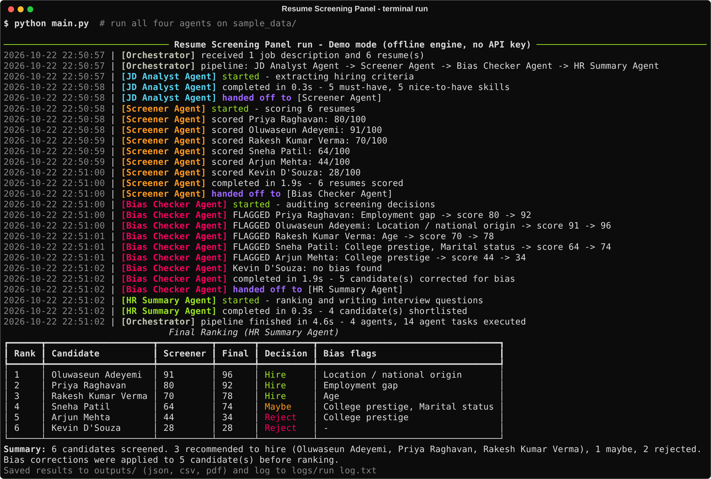
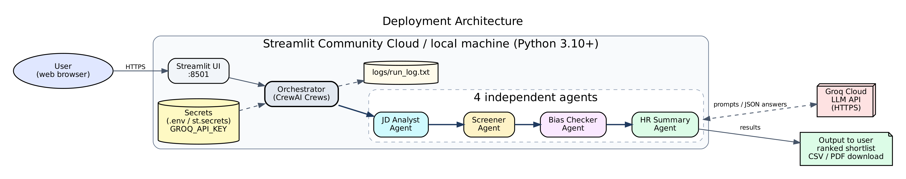

# 🧑‍💼 Resume Screening Panel – a Multi-Agent HR System

Four AI agents built with **CrewAI** work together like an interview panel: they read a job
description, screen resumes, **audit the screening for bias**, and produce a fair, ranked
shortlist with tailored interview questions.

| # | Agent | What it does |
|---|-------|--------------|
| 1 | 🧠 **JD Analyst Agent** | Turns the job description into structured criteria (must-have / nice-to-have skills, experience, qualifications) |
| 2 | 📊 **Screener Agent** | Scores each resume 0–100 with a per-skill evidence table and lists any other factors it considered |
| 3 | ⚖️ **Bias Checker Agent** | Flags decisions based on name, gender, age, religion, college prestige, location/origin, marital status or employment gaps, and corrects the score |
| 4 | 📝 **HR Summary Agent** | Ranks candidates, recommends Hire / Maybe / Reject and writes 3–5 interview questions per shortlisted candidate |



## Demo

- 🎥 **Demo video:** [Google Drive link – PASTE LINK HERE]() (also in `docs/demo/demo.mp4`)
- 📄 **Project report:** [`docs/Project_Report.docx`](docs/Project_Report.docx)




## Quick start

```bash
git clone https://github.com/<your-username>/resume-screening-panel.git
cd resume-screening-panel
python -m venv .venv
.venv\Scripts\activate          # Windows   (macOS/Linux: source .venv/bin/activate)
pip install -r requirements.txt
```

### Add your Groq API key (free)

1. Create a key at <https://console.groq.com> → **API Keys**.
2. Copy `.env.example` to `.env` (`copy .env.example .env` on Windows) and set
   `GROQ_API_KEY=gsk_...`

Without a key the app runs in **demo mode**: the same CrewAI agents and pipeline, answered by a
built-in offline engine, so you can try everything without internet or an account.

### Run

```bash
streamlit run app.py      # web app at http://localhost:8501
python main.py            # command line, runs on sample_data/
python -m pytest          # 15 tests (always in demo mode)
```

Use your own files with the CLI: `python main.py --jd my_jd.pdf --resumes cv1.pdf cv2.txt`

## Proof of multiple agents

Every run writes a timestamped hand-off log to the terminal and to `logs/run_log.txt`:

```
2026-10-22 22:29:31 | [JD Analyst Agent] started - extracting hiring criteria
2026-10-22 22:29:32 | [JD Analyst Agent] handed off to [Screener Agent]
2026-10-22 22:29:34 | [Screener Agent] handed off to [Bias Checker Agent]
2026-10-22 22:29:34 | [Bias Checker Agent] FLAGGED Priya Raghavan: Employment gap -> score 80 -> 92
2026-10-22 22:29:36 | [Bias Checker Agent] handed off to [HR Summary Agent]
2026-10-22 22:29:36 | [Orchestrator] pipeline finished in 4.6s - 4 agents, 14 agent tasks executed
```



## Sample data

`sample_data/` has a Junior Python Developer job description and six **fictional** resumes
(three TXT, three PDF): two strong, two average and two weak. Five of them contain deliberate
bias traps (maternity career break, overseas background, age, tier-3 college + marital status,
tier-1 college halo); the sixth is a control with no traps.

## Project structure

```
agents/          one file per agent (role, goal, backstory + offline engine)
tasks/prompts.py task descriptions and JSON contracts
orchestrator.py  runs the agents in sequence and logs every hand-off
app.py           Streamlit UI      main.py  command-line runner
utils/           LLM factory, logger, PDF/TXT parser, skills, CSV/PDF export
tests/           pytest suite
scripts/         screenshots, demo video, diagrams, report builder
docs/            report, screenshots, diagrams, demo video
```

## Deployment (Streamlit Community Cloud)

1. Push this repo to GitHub (`.env` is ignored by Git).
2. At <https://share.streamlit.io> click **Create app** and pick `app.py`.
3. In **Advanced settings → Secrets** add `GROQ_API_KEY = "gsk_..."`.
4. Deploy.



## Regenerating the documentation

```bash
python main.py                          # refresh outputs/results.json
python scripts/make_diagrams.py         # needs Graphviz installed
streamlit run app.py                    # in another terminal, then:
python scripts/capture_demo.py screenshots
python scripts/capture_demo.py video    # needs ffmpeg
python scripts/terminal_capture.py
python scripts/build_report.py          # needs LibreOffice for the page numbers
```

## Tech stack

Python · CrewAI · Groq (Llama 3.3 70B) · Streamlit · pypdf · pandas · reportlab · rich · pytest ·
Playwright · Graphviz · python-docx

---
Student project for the Coursera OJT – Multi-Agent Systems. All candidates in `sample_data/` are fictional.
